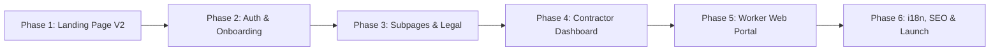

# Digital Labour Chowk (DLC) V2 — Implementation Phases & Roadmap

---

## Phase Overview

---

## Phase 1: Foundation & Landing Page V2 (Current Status: Complete & Verified)
* [x] **Project Initialization**: Next.js 16+ App Router, TypeScript, and Tailwind CSS configured in `dlc-website-v2/`.
* [x] **Header & Editorial Dropdowns**:
  * Top utility helpline bar with telephone and social icons.
  * Single-column dropdown for **About Us** and **Resources** with 3px `#0C59D4` top border and clean dividers.
  * 3-column mega menu for **Hire Manpower** (Civil Trades, Whom We Serve, Compliance & Rates).
  * 2-column menu for **For Workers** (Rozgar & App, Benefits & Suraksha).
  * Direct **Investor Relations** link and "Get in Touch" CTA.
  * Mobile slide-down drawer with collapsible accordions.
* [x] **Hero Canvas**: Aspect-video 6:57 min Vimeo documentary stream with floating sound toggle.
* [x] **Popular Searches Grid**: 2-row 3-col responsive trade showcase with 5 worker cutouts, Hindi sub-labels, and watermark typography.
* [x] **Bharat Ke Super Founders Banner**: 1366×172 responsive banner with video popup modal.
* [x] **Curtain Reveal Section**: 3 sticky viewport stacking interactive cards ("FIND JOB", "FIND WORKERS", "FIND BUSINESS").
* [x] **Stats Marquee & Testimonials Split Section**:
  * Right-to-left moving data marquee (350k+ Workers, 20k+ Contractors, etc.).
  * Fixed signature blue quote block on the left and speech-bubble review carousel on the right.
* [x] **App Download CTA**: 3D angled smartphone mockup with dynamic island, SVG QR code, and floating rating badges.
* [x] **Responsive Footer**: Mobile accordion architecture reducing scroll by ~70%, 5 policy links (Terms, Privacy, Cancellation, Refund, Disclaimer), helpline pills.
* [x] **File Consolidation**: Landing page sections unified into `components/Home.tsx` (`HomeContent`).

---

## Phase 2: Authentication & Onboarding Portals
* [ ] **Worker Login & OTP Verification**:
  * Mobile number + Aadhaar-linked OTP verification.
  * Multilingual selector on the login screen (Hindi, Bhojpuri, Maithili, English).
  * Digital trade selection and basic profile completion.
* [ ] **Contractor / Business Registration**:
  * Company GSTIN and MSME registration verification.
  * Project site address and billing entity details.
  * Jamadar / Sub-contractor gang size declaration.
* [ ] **Role-Based Auth Redirection**:
  * Middleware routing authenticated users to either Contractor Dashboard or Worker Hub.

---

## Phase 3: Core Subpages & Content Modules
* [ ] **About Us Dedicated Page (`/about-us`)**:
  * CIMPS incubation journey, detailed timeline from 2020 to present.
  * Founders' bios, advisory board, and operational leadership.
  * Interactive map of 15+ national industrial hubs.
* [ ] **Hire Construction Workers (`/hire-construction-workers-business`)**:
  * Trade catalog with skill grade definitions (Unskilled, Semi-Skilled, Skilled, Highly Skilled).
  * Instant 2-Hour Manpower Dispatch request form.
* [ ] **Worker Portal (`/worker`)**:
  * Daily wage job board (Aaj Ka Rozgar) searchable by pincode/city.
  * Benefits explanation: DBT wage process, ₹5 Lakh accidental insurance, Digital Trade ID.
* [ ] **Resources & Insights (`/blog`)**:
  * Searchable blog index, construction trend whitepapers, site automation articles.
* [ ] **Statutory & Legal Pages**:
  * Terms and Conditions (`/terms-and-conditions`)
  * Privacy Policy (`/privacy-policy`)
  * Cancellation Policy (`/cancellation-policy`)
  * Refund Policy (`/refund-policy`)
  * Legal Disclaimer (`/disclaimer`)

---

## Phase 4: Contractor Dashboard & Workforce Management
* [ ] **Site Requirement Posting**:
  * Multi-trade requirement wizard (Select date, site address, required headcount, trade type).
* [ ] **Live Dispatch Tracker**:
  * Real-time status: Dispatched → En Route → On Site.
* [ ] **Digital Muster Roll & Geo-Fenced Biometric Attendance**:
  * Daily worker check-in/check-out logs with GPS geofence validation.
* [ ] **Wage Payout & Invoicing**:
  * Automated wage calculation, GST invoice generation, and DBT escrow confirmation.

---

## Phase 5: Worker Rozgar Web Portal & Mobile App Handshake
* [ ] **Web Job Application Flow**:
  * Quick 1-click "Apply for Work" for registered workers.
* [ ] **Digital Trade ID Card Viewer**:
  * QR-verifiable worker card displaying verified skill rating, completed site days, and insurance status.
* [ ] **Helpline & Grievance Ticketing**:
  * Toll-free integration (1800-202-0991) and WhatsApp Bot job ping connection.

---

## Phase 6: Multilingual Support (i18n), SEO, Analytics & Production Cutover
* [ ] **Internationalization (i18n)**:
  * Full translation support for Hindi (`hi`), English (`en`), and regional dialects.
* [ ] **SEO & Structured Data**:
  * Schema.org `Organization`, `JobPosting`, and `WebSite` JSON-LD metadata.
  * Dynamic Open Graph images and Twitter cards.
* [ ] **Core Web Vitals Optimization**:
  * Target: 95+ Mobile and 99+ Desktop Performance score on Lighthouse.
* [ ] **Production Cutover**:
  * DNS switch from legacy WordPress site to Next.js production cluster.
